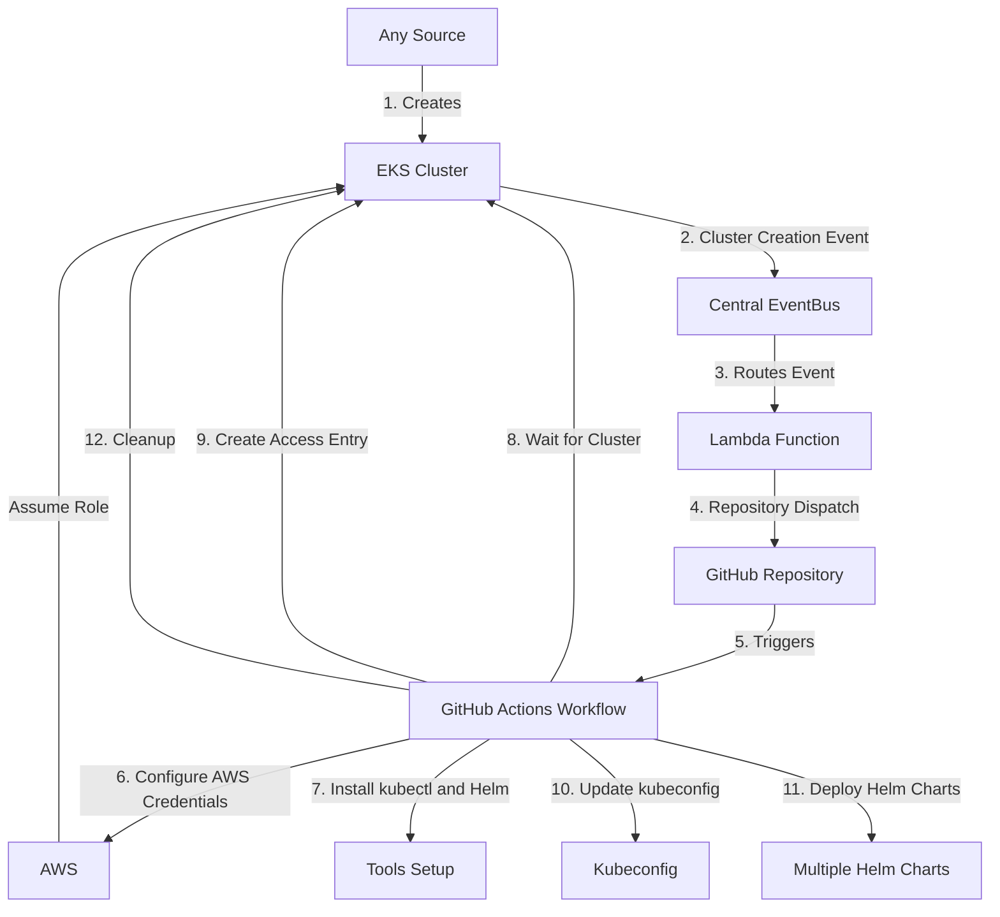

# AWS EKS Management

Event-driven management of AWS EKS (Elastic Kubernetes Service) clusters. When a cluster is created in any member AWS account, an event is forwarded to a central EventBus, a Lambda function dispatches a GitHub Actions workflow, and the workflow deploys a standard set of Helm charts (monitoring, cost, security) to the new cluster.

> **Note:** This is a reference implementation. Names such as `example-org`, `platform-team@example.com` and the `stack-deployer` action are placeholders. The `stack-deployer` action is a stand-in for whatever tool you use to deploy the CloudFormation stacks under `config/`; replace it with your own (or deploy the templates directly with the AWS CLI or CloudFormation). Review and adapt IAM roles, secrets and account settings before use.

## Prerequisites

- An AWS Organization with member accounts and an EventBridge event bus in a central account
- A GitHub App (or token) allowed to send `repository_dispatch` events to this repository, stored in AWS Secrets Manager
- An IAM role per member account that GitHub Actions can assume via OIDC
- GitHub environments named `nonp` and `prod`, each with an `AWS_ROLE` variable
- Secrets for the optional integrations: `CLOUDABILITY_API_KEY` and the `WIZ_*` values

## Environments

Two environments are used: `nonp` (non-production) and `prod` (production). Both the GitHub environments and the `environment` tag on each EKS cluster use these values. Clusters must also carry the tag `Managed = True`, otherwise they are skipped.

## System Architecture and Workflow



### Event-Driven Architecture for EKS Management

The system implements an event-driven architecture where any EKS cluster creation in a member AWS account automatically triggers an event that is forwarded to a central EventBus. This event is then processed by a Lambda function, which initiates the GitHub Actions workflow. Here's a detailed explanation of this process:

1. **EKS Cluster Creation**: A new EKS cluster is created in any member AWS account (through CloudFormation, AWS Console, CLI, or any other means).

2. **Event Forwarding and Processing**: 
   - When an EKS cluster is created, the event is automatically forwarded to the central EventBus named "eks-mgmt-bus".
   - The EventBus is configured with full detail logging for comprehensive event tracking.

3. **Lambda Function**: A Python Lambda function is set up to listen for specific events on the EventBus. The function:
   - Processes EKS cluster creation events
   - Extracts cluster details (name, region, account)
   - Uses AWS Secrets Manager to retrieve GitHub authentication token
   - Triggers GitHub repository dispatch events with cluster information
   - Includes comprehensive logging for troubleshooting
   - Has a 600-second (10-minute) timeout
   - Uses Python 3.11 runtime
   - Implements robust error handling and detailed logging

4. **Event Flow and Permissions**:
   - The EventBus policy allows any AWS account within the organization to send events:
     * Uses a wildcard principal (`"*"`) with an organization ID condition
     * Only accepts events from accounts that belong to the specified AWS Organization
     * The organization ID is passed as a parameter during deployment
   - The EventBus routes these events to the Lambda function through an EventBridge rule
   - The Lambda function has IAM permissions to:
     * Access CloudWatch Logs
     * Read from AWS Secrets Manager
   - EventBridge has permissions to invoke the Lambda function

5. **GitHub Actions Trigger**:
   - The Lambda function uses the GitHub API to create a repository dispatch event
   - It includes the extracted information (cluster name, region, account) in the client payload
   - Uses a secret token stored in AWS Secrets Manager for GitHub authentication
   - Implements error handling and logging for API interactions

6. **Workflow Execution**:
   - The repository dispatch event triggers the `deploy-eks-helm.yml` workflow in GitHub Actions
   - The workflow uses the information provided in the client payload to configure AWS credentials and interact with the newly created EKS cluster
   - Supports deployment of multiple Helm charts to the cluster

This event-driven architecture allows for automatic deployment of necessary components whenever a new EKS cluster is created, ensuring consistency and reducing manual intervention.

## Repository Structure

```
.
├── .github/
│   ├── ISSUE_TEMPLATE/
│   └── workflows/
│       ├── audit.yml
│       ├── deploy-eks-helm.yml
│       ├── manual-scanner.yml
│       └── deployment.yml
├── charts/
│   └── nginx-values.yaml
├── config/
│   └── platform/
│       ├── eventbus.yaml
│       └── helm-deploy-cloudability.yaml
├── scripts/
│   ├── audit_clusters.py
│   ├── check_cluster_tags.py
│   ├── deploy_charts.py
│   ├── requirements.txt
│   └── wait_for_cluster.py
├── templates/
│   ├── eventbus.yaml
│   └── helm-deploy-charts.yaml
├── .gitattributes
├── .gitignore
├── LICENSE
├── charts.yaml
├── README.md
├── requirements.txt
└── wiz_values.yaml
```

## Workflows

### 1. Deploy EKS Helm Charts Workflow (deploy-eks-helm.yml)

**Trigger:** Repository dispatch event of type `eks-cluster-created`

**Environment:** nonp

**Permissions:** write-all

**Purpose:** Automatically deploys Helm charts and monitoring tools to newly created EKS clusters.

**Workflow Steps:**

1. **Checkout Repository** - Checks out the code from the repository

2. **Print AWS Role** - Displays the AWS role ARN for debugging

3. **Configure AWS Credentials** - Assumes the AWS role using OIDC authentication
   - Region: ca-central-1
   - Role format: `arn:aws:iam::{account}:role/platform/service/platform-{account}-EKS-Mgmt`
   - Session duration: 900 seconds (15 minutes)
   - Session name: GitHubActionsSession

4. **Test AWS Role Assumption** - Verifies AWS credentials by calling `aws sts get-caller-identity`

5. **Check Cluster Tags** - Validates required cluster tags using `check_cluster_tags.py`
   - Required tags: "Managed" = "True" and "environment" = "nonp/prod"
   - Uses `continue-on-error: true` to prevent workflow failure
   - Sets output variable `tags_valid` for conditional execution of subsequent steps

6. **Install kubectl** - Sets up kubectl CLI tool (conditional on valid tags)

7. **Install Helm** - Sets up Helm package manager (conditional on valid tags)

8. **Set up Python** - Installs Python 3.11 runtime (conditional on valid tags)

9. **Install Dependencies** - Installs Python packages from `scripts/requirements.txt` (conditional on valid tags)

10. **Wait for Cluster** - Runs `wait_for_cluster.py` to ensure cluster is ACTIVE
    - Sets output variable `cluster_ready` for subsequent steps
    - Fails the workflow if cluster is not ready

11. **Display AWS Identity** - Shows current AWS identity for verification

12. **Create Access Entry** - Creates cluster access entry for the assumed role
    - Creates STANDARD access entry
    - Associates AmazonEKSClusterAdminPolicy
    - Sets output variable `access_entry_created`

13. **Update kubeconfig** - Updates local kubeconfig for cluster access

14. **Deploy Simple Helm Charts** - Runs `deploy_charts.py` to deploy charts from `charts.yaml`

15. **Deploy Cloudability Helm Chart** - Deploys metrics-agent for cost monitoring
    - Repository: https://cloudability.github.io/metrics-agent/
    - Namespace: cloudability (auto-created)
    - Uses secret: CLOUDABILITY_API_KEY

16. **Deploy Wiz** - Deploys Wiz security integration
    - Repository: https://charts.wiz.io/
    - Namespace: wiz
    - Creates secrets: sensor-image-pull, wiz-api-token
    - Uses secrets: WIZ_CLIENT_ID, WIZ_SECRET, WIZ_PULLKEY_USERNAME, WIZ_PULLKEY_PASSWORD
    - Values file: wiz_values.yaml

17. **Remove Access Entry** - Cleanup step to remove the temporary access entry

**Key Features:**
- Conditional execution based on tag validation and cluster readiness
- Graceful handling of invalid tags (continues but skips deployment steps)
- Comprehensive logging for troubleshooting
- Automatic cleanup of temporary access entries
- Supports multiple Helm chart deployments with custom values

**Environment Variables Used:**
- `CLUSTER_NAME`: From client_payload.cluster_name
- `CLUSTER_REGION`: From client_payload.region
- `CLUSTER_ACCOUNT`: From client_payload.account
- `AWS_ROLE`: Constructed from account number

### 2. Audit Helm Charts Workflow (audit.yml)

**Trigger:** 
- Scheduled: Daily at 2 AM UTC (cron: "0 2 * * *")
- Manual: workflow_dispatch with environment selection

**Environment:** Configurable (nonp or prod)

**Permissions:** write-all

**Purpose:** Ensures all required Helm charts remain deployed across managed EKS clusters.

**Workflow Steps:**

1. **Checkout Code** - Checks out the repository

2. **Set up Helm** - Installs Helm package manager

3. **Print AWS Role** - Displays the AWS role from environment variables

4. **Configure AWS Credentials** - Assumes AWS role
   - Region: ca-central-1
   - Role: From environment variable `AWS_ROLE`
   - Session duration: 900 seconds
   - Session name: GitHubActionsSession

5. **Test AWS Role Assumption** - Verifies credentials

6. **Audit Helm Charts** - Runs `audit_clusters.py` to check and reinstall missing charts
   - Lists all EKS clusters in configured region (`AWS_REGION`, default ca-central-1)
   - Checks each cluster for charts defined in charts.yaml
   - Automatically reinstalls missing charts

**Key Features:**
- Automated daily maintenance
- Manual trigger option for on-demand audits
- Environment-specific execution
- Automatic remediation of missing charts

### 3. Deployment Workflow (deployment.yml)

**Trigger:** Manual workflow_dispatch only

**Environment:** Configurable (nonp or prod)

**Permissions:** write-all

**Purpose:** Deploys the core EventBus and Lambda infrastructure using Stack Deployer.

**Workflow Inputs:**
- `environment`: Target environment (nonp or prod)
- `stage`: Deployment stage (validate, build, or teardown)

**Workflow Steps:**

1. **Checkout Repository** - Checks out the code

2. **Print AWS Role** - Displays the AWS role for debugging

3. **Configure AWS Credentials** - Assumes AWS role
   - Region: ca-central-1
   - Role: From environment variable `AWS_ROLE`
   - Session duration: 900 seconds

4. **Test AWS Role Assumption** - Verifies credentials

5. **Deploy Core Components** - Uses Stack Deployer GitHub Action to deploy infrastructure
   - App name: eks-instance-mgmt
   - Environment: platform
   - Region: ca-central-1
   - Deploys CloudFormation stacks defined in config/platform/

**Environment Variables Required:**
- `AWS_ROLE`: IAM role ARN for deployment
- `ORGID`: AWS Organization ID
- `MASTER_ACCOUNT_ID`: Master account ID
- `OPS_ACCOUNT`: Operations account ID
- `S3_BUCKET`: S3 bucket for artifacts
- `S3_KEY`: S3 key prefix

**Secrets Required:**
- `STACK_DEPLOYER_APP_ID`: Stack Deployer application ID
- `STACK_DEPLOYER_APP_KEY`: Stack Deployer application key

**Key Features:**
**Required Tags:**
- `Managed`: Must be set to "True" (case-insensitive)
- `environment`: Must be "nonp" or "prod" (case-insensitive)

**Usage:**
```bash
python check_cluster_tags.py --cluster-name CLUSTER_NAME --region REGION
```

**Exit Codes:**
- 0: Tags are valid
- 1: Tags are missing or invalid

### 3. deploy_charts.py
Deploys multiple Helm charts to an EKS cluster based on the charts.yaml configuration.

**Features:**
- Reads the `charts.yaml` file to get the list of charts to deploy
- For each chart:
  - Adds the chart repository
  - Installs or upgrades the chart using the specified version and values file (if provided)
- Supports dynamic deployment of multiple charts without modifying the script

**Usage:**
```bash
python deploy_charts.py --cluster CLUSTER_NAME --region REGION
```

### 4. audit_clusters.py
Audits all EKS clusters in configured region (`AWS_REGION`, default ca-central-1) to ensure required Helm charts are deployed.

**Features:**
- Lists all EKS clusters in the configured region (`AWS_REGION`, default ca-central-1)
- For each cluster, checks if charts from charts.yaml are installed
- Automatically reinstalls missing charts
- Used by the audit.yml workflow for scheduled maintenance

**Usage:**
```bash
python audit_clusters.py
```

### 5. requirements.txt
Lists Python dependencies required by the scripts:
- boto3: AWS SDK for Python
- argparse: Command-line argument parsing
- pyyaml: YAML file parsing

## Usage

This repository provides an event-driven system for managing EKS resources in the Cloud Platform. When an EKS cluster is created in any member AWS account, the event is automatically forwarded to a central EventBus, triggering a GitHub Actions workflow that deploys necessary components and configurations through multiple Helm charts.

## Troubleshooting

If you encounter issues with the deployment process, consider the following:

1. **AWS Credentials**: Ensure that the AWS role specified in the workflow has the necessary permissions to interact with EKS and deploy resources.

2. **Cluster Status**: The workflow waits for the cluster to be in an active state. If this step fails, check the EKS cluster status in the AWS console.

3. **Cluster Tags**: If the workflow completes successfully but doesn't deploy any Helm charts, check if the required tags ("Managed" and "environment") are set correctly on the EKS cluster.

4. **API Authentication**: The workflow assumes the cluster is using API authentication. If you encounter errors related to creating access entries, verify that API authentication is enabled for your EKS cluster.

5. **Helm Chart Deployments**: If any Helm chart deployment fails:
   - Check the Helm release status and logs in the EKS cluster
   - Verify the chart values and configuration
   - Ensure the chart repository is accessible
   - Check for any version compatibility issues
   - Review the chart's documentation for specific requirements

6. **EventBus Configuration**: If events are not being processed, verify:
   - The EventBus configuration and permissions are correct
   - The member account is part of the specified AWS Organization
   - The event pattern matches the EKS cluster creation events

7. **Lambda Function**: If the GitHub Actions workflow is not triggered:
   - Check the Lambda function logs in CloudWatch
   - Verify the GitHub token in Secrets Manager is valid
   - Ensure the EventBridge rule is properly configured
   - Check the Lambda function's IAM role permissions

For persistent issues, please open a GitHub issue.

## Contributing

Issues and pull requests are welcome. Please use the issue templates under `.github/ISSUE_TEMPLATE/`.

## License

MIT. See [LICENSE](LICENSE).
